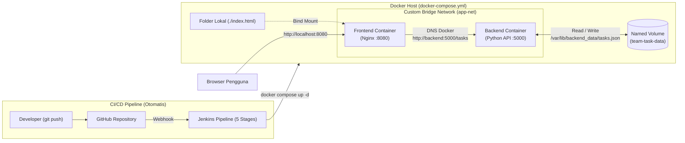

# 📋 Papan Catatan Tugas Kelompok (Team Task & Note List)
**Tugas Besar UTS Cloud Computing — Panduan Ujian Chunin**  
*Cloud-Native Fullstack Application & Automated CI/CD Pipeline*

---

## 👥 Identitas Kelompok L
| No | Nama Lengkap | NIM | Peran |
| :-: | :--- | :--- | :--- |
| 1 | [Nama Anggota 1] | [NIM Anggota 1] | Backend & Docker Architecture |
| 2 | [Nama Anggota 2] | [NIM Anggota 2] | Frontend & UI/UX |
| 3 | [Nama Anggota 3] | [NIM Anggota 3] | Jenkins CI/CD & GitHub Webhook |
| 4 | [Nama Anggota 4] | [NIM Anggota 4] | Dokumentasi & Pengujian |

---

## 📌 Studi Kasus yang Dipilih
**Nomor 6: Papan Catatan Tugas Kelompok (Team Task & Note List)**
* **Skenario:** Aplikasi *todo list* sederhana untuk membagi tugas antar-anggota tim.
* **Fitur REST API & UI:**
  * `GET /tasks` — Menampilkan seluruh daftar tugas kelompok.
  * `POST /tasks` — Menambahkan tugas baru ke dalam daftar.
  * `DELETE /tasks?index=X` — Menghapus/menyelesaikan tugas pada urutan ke-`X`.
* **Storage Volume:** File `tasks.json` disimpan di dalam Docker Named Volume **`team-task-data`** (`/var/lib/backend_data/tasks.json`).

---

## 🏗️ Diagram Arsitektur Docker & CI/CD



### Penjelasan Komponen Arsitektur:
1. **Frontend Service (`team-task-frontend`):** Menggunakan image `nginx:alpine` pada port `8080:80`. Terhubung dengan folder host lokal menggunakan **Bind Mount** (`./:/usr/share/nginx/html:ro`) sehingga perubahan pada `index.html` langsung terlihat tanpa *rebuild image*.
2. **Backend Service (`team-task-backend`):** Dibangun dari `Dockerfile` (`python:3.11-slim`) yang menjalankan `app.py` pada port `5000:5000`.
3. **Custom Bridge Network (`app-net`):** Mengisolasi komunikasi antara kontainer `frontend` dan `backend`. Nginx meneruskan request `/tasks` ke `http://backend:5000/tasks` menggunakan DNS internal Docker (`backend`).
4. **Docker Named Volume (`team-task-data`):** Menyimpan file `tasks.json` di `/var/lib/backend_data/tasks.json` agar data tetap aman (*Data Immunity*) meskipun kontainer `backend` dihapus paksa (`docker rm -f`).

---

## 📂 Struktur Berkas Repositori
```text
.
├── app.py               # Backend Python REST API (GET, POST, DELETE /tasks)
├── index.html           # Frontend HTML & Vanilla JS (fetch API asynchronous)
├── Dockerfile           # Konfigurasi image untuk Backend Python
├── docker-compose.yml   # Definisi multi-container, Named Volume, Bind Mount, & Network
├── Jenkinsfile          # Declarative Pipeline 5 Stage untuk otomatisasi CI/CD
└── README.md            # Dokumentasi proyek & panduan instalasi
```

---

## 🚀 Langkah Instalasi & Menjalankan Secara Lokal

### 1. Prasyarat
* **Docker** & **Docker Compose** (Docker Desktop sudah menyala)
* **Git**

### 2. Menjalankan Aplikasi dengan Docker Compose
Buka terminal pada folder proyek, lalu jalankan:
```bash
docker compose up -d --build
```

### 3. Mengakses Aplikasi
* **Tampilan Web (Frontend UI):** Buka browser ke `http://localhost:8080`
* **Endpoint REST API (Backend):** `http://localhost:5000/tasks`

### 4. Contoh Pengujian API via Terminal (`curl`)
* **GET (Lihat Daftar Tugas):**
  ```bash
  curl http://localhost:5000/tasks
  ```
* **POST (Tambah Tugas Baru):**
  ```bash
  curl -X POST http://localhost:5000/tasks \
    -H "Content-Type: application/json" \
    -d '{"title":"Membuat Video Demo","assignee":"Budi","priority":"Tinggi","note":"Durasi 5-8 menit"}'
  ```
* **DELETE (Hapus Tugas Index ke-0):**
  ```bash
  curl -X DELETE "http://localhost:5000/tasks?index=0"
  ```

---

## 🛡️ Simulasi *Data Immunity* (Uji Ketahanan Data)

Untuk membuktikan bahwa **Named Volume (`team-task-data`)** menjaga data tetap aman saat kontainer dihancurkan:

1. Tambahkan 2–3 tugas melalui halaman web `http://localhost:8080`.
2. Hapus paksa kontainer Backend:
   ```bash
   docker rm -f team-task-backend
   ```
3. Nyalakan kembali kontainer Backend:
   ```bash
   docker compose up -d
   ```
4. *Refresh* halaman `http://localhost:8080` — **seluruh data tugas terbukti masih utuh!**

---

## ⚙️ Panduan Setup Jenkins CI/CD & GitHub Webhook

### 1. Membuat GitHub Personal Access Token (PAT)
1. Buka **GitHub** → **Settings** → **Developer settings** → **Personal access tokens** → **Tokens (classic)**.
2. Klik **Generate new token (classic)**, beri nama `Jenkins CI/CD UTS Token`.
3. Centang izin:
   * `[x] repo` (Akses repositori)
   * `[x] admin:repo_hook` (Webhook)
4. Salin token (`ghp_xxxx...`) dan simpan ke Jenkins pada menu **Manage Jenkins** → **Credentials** → **Global** → **Add Credentials** (*Username with password*).

### 2. Membuat Pipeline Job di Jenkins
1. Pada dashboard Jenkins, klik **New Item** → Masukkan nama `team-task-cicd` → Pilih **Pipeline** → **OK**.
2. Pada bagian **Build Triggers**, centang **GitHub hook trigger for GITScm polling**.
3. Pada bagian **Pipeline**:
   * **Definition:** `Pipeline script from SCM`
   * **SCM:** `Git`
   * **Repository URL:** Masukkan URL repositori GitHub kelompok.
   * **Credentials:** Pilih kredensial GitHub PAT yang sudah dibuat.
   * **Branch Specifier:** `*/main`
   * **Script Path:** `Jenkinsfile`
4. Klik **Save**.

### 3. Mengatur GitHub Webhook
1. Jika Jenkins berjalan di lokal laptop, ekspos port Jenkins (`8080` / `9090`) ke internet menggunakan **ngrok**:
   ```bash
   ngrok http 9090
   ```
2. Buka repositori GitHub → **Settings** → **Webhooks** → **Add webhook**.
3. Isi **Payload URL**: `https://<url-ngrok-kamu>/github-webhook/`
4. Pilih **Content type**: `application/json`
5. Pilih **Just the `push` event** → Klik **Add webhook**.
6. Sekarang setiap kali anggota tim melakukan `git push origin main`, Jenkins akan otomatis menjalankan 5 stage di `Jenkinsfile`!

